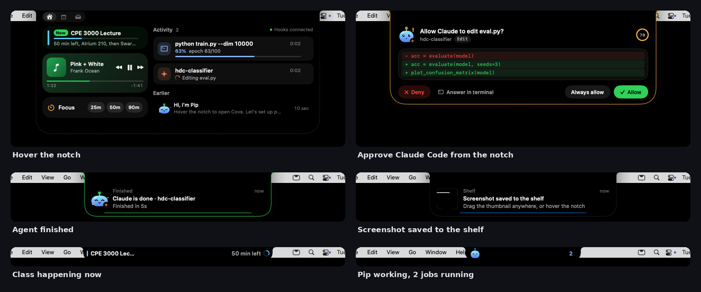

# Cove

**A Dynamic Island for the MacBook notch, built for people who run AI agents.**

Cove turns the black space around the notch into a small live surface, like the iPhone's Dynamic Island. It shows what Claude Code and Codex are doing, lets you approve Claude's permission prompts without switching windows, and pings you when work finishes. It also counts down to your next class, catches screenshots on a shelf, and replaces the volume and brightness pop-ups. Nori, a small black buddy with glowing eyes, reacts to all of it.

Native Swift and SwiftUI, MIT licensed, macOS 14 or later.



## What it does

| | |
|---|---|
| **Agents** | Claude Code and Codex sessions show live beside the notch ("Editing eval.py", "$ pytest"), then a banner with the final message. Reply from the banner to keep the conversation going. The AI tab lists today's finished runs. |
| **Talk to Claude** | Hold fn, ask a question or give a task, and let go. Claude Code answers in the island as it writes. |
| **Cloud agents** | Message your Claude sessions on claude.ai/code from the AI tab, or start a new one for a repo. |
| **Approvals** | When Claude Code asks permission, the island drops down with the command or a red and green diff, plus **Allow**, **Always allow** and **Deny**. ⌃⌥Y and ⌃⌥N work too. |
| **Cloud and CI** | Claude sessions on claude.ai show up through the pull requests they open. Your GitHub Actions runs show live, with **Re-run** on a failure and **Run Deploy** on a pass. |
| **Your phone** | Optional pushes to your phone (through ntfy) when an agent finishes or needs you while you're away, with Allow and Deny buttons. |
| **Classes** | "CPE 3000 Lecture, 50 min left" beside the notch, a heads-up with a Join button before each class, and a Due soon list from D2L, Canvas or Google Calendar. |
| **Files** | Every new screenshot lands on a shelf you can drag from. Drop any file on the notch to AirDrop it or keep it. Browse and search your Mac's files from the notch, and turn JPEGs into a PDF, PDFs into images, or images into another format. |
| **Sports** | Pin an NBA, NFL or college football game's score beside the notch, with play-by-play in the Sports tab. |
| **iPhone touches** | Quick timers, a charging animation, the green and orange camera and mic dot, AirPods battery, Now Playing, and the volume and brightness meter. It works on external displays too. |

## Install

1. Download **Cove.zip** from the [latest release](../../releases/latest), double-click it and drag **Cove.app** into **Applications**.
2. Open it. macOS says it can't verify the developer because Cove isn't notarized. Click **Done**, open **System Settings → Privacy & Security**, scroll down and click **Open Anyway**. You only do this once.

Cove updates itself from then on. Releases are signed with the same certificate every time, so the permissions you grant stay granted.

To build it yourself instead, run `git clone https://github.com/jvthomas702/Cove.git && cd Cove && ./scripts/install.sh`. You need Xcode or the Command Line Tools (`xcode-select --install`).

## First launch

A short welcome window walks you through three steps:

1. **Hello.** What Cove does.
2. **Pick.** Connect Claude Code (Cove adds its hooks to `~/.claude/settings.json` and keeps a backup) and Codex, and choose what the island shows: classes, screenshots, the volume meter, other apps' notifications and sports.
3. **Allow.** Only the macOS permissions those picks need, each with its own **Allow** button.

Then hover the notch, or press ⌃⌥Space, to open the island. Cove opens at login. Everything else is in **Settings**, from the menu bar icon or by opening Cove.app again, and **Set Up Cove…** in the same menu runs the welcome window again.

The [guide](docs/GUIDE.md) covers every feature in detail: calendar links, the AI workspace, browser chat tabs, cloud sessions, the phone, CI buttons, timers, screenshots and Gamecast.

## Privacy

Everything runs on your Mac. Cove's server listens only on `127.0.0.1` and refuses requests from web pages. Calendar links are kept out of diagnostics. Phone pings are the one thing that leave the Mac, and only if you turn them on. The guide explains how to run your own ntfy server instead.

## Terminal and API

```bash
cove-run python train.py --epochs 50          # live timer, then a ping
cove-run --name "Swarm sim" -- ros2 launch swarm sim.launch.py
cove-notify "Coffee's ready"
cove-notify --kind attention "Robot 3 lost localization" "Battery at 12%"
cove-notify --id sweep --kind running --progress 0.4 "HDC sweep" "dim=10000, 4/10"
```

From Python, `examples/cove_progress.py` pushes a progress ring with one line per epoch.

Cove listens on `127.0.0.1:7777` (this Mac only). It accepts requests from local programs and browser extensions, and refuses requests from web pages, so a site you visit can't post to your notch.

| Method | Path | Body |
|---|---|---|
| `GET` | `/health` | |
| `POST` | `/event` | `{"title": "…", "body": "…", "kind": "info", "id": "…", "progress": 0.4, "source": "command", "sticky": false}` |
| `POST` | `/hook/claude` | Claude Code hook JSON |
| `POST` | `/hook/claude/permission` | PermissionRequest JSON, held open until you decide |
| `POST` | `/hook/codex` | Codex notify JSON |

`kind` is `info`, `running`, `done`, `error`, `attention` or `clear`. Events with the same `id` update one live activity.

## How it's built

See the [architecture diagram](docs/architecture/) for how the pieces connect: an interactive page, with every box linked to its source.

```
Sources/Cove/
├── AppDelegate.swift            lifecycle, menu bar, routing, applying settings
├── IslandModel.swift            all island state: activities, banners, approvals, calendar, shelf
├── NotchWindow.swift            borderless panel above the menu bar, sized to the island
├── Views/                       island shape and states, Nori, settings window, design tokens
└── Services/
    ├── EventServer.swift        HTTP server on 127.0.0.1 (Network.framework)
    ├── AgentBridge.swift        Claude Code hooks, permission prompts, Codex
    ├── CloudSessions.swift      pull requests from Claude cloud sessions, via GitHub
    ├── PhoneRelay.swift         agent pings to your phone and answers back, via ntfy
    ├── Integrations.swift       permissions, hooks, CLI tools, browser extension setup
    ├── CalendarMonitor.swift    EventKit classes and reminders
    ├── ICSFeeds.swift           calendar links (D2L, Canvas, Google iCal): download and parse
    ├── ScreenshotWatcher.swift  FSEvents on the screenshot folder, plus Spotlight
    ├── NotificationMirror.swift Notification Center's database (read only)
    ├── NowPlayingMonitor.swift  Music and Spotify
    ├── SystemControls.swift     volume, brightness, media keys
    ├── MediaUseMonitor.swift    camera and microphone in use (privacy dot)
    └── BatteryMonitor.swift     power source changes
extension/                       browser extension (Manifest V3)
bin/                             cove-run, cove-notify and hook scripts (bundled into the app)
Tests/                           unit tests (swift test)
```

CI (`.github/workflows/build.yml`) builds, runs the tests, packages and verifies the app, launches it with a debug-only API to walk through every state, checks the server's security rules and the screenshot pipeline end to end, measures idle CPU, and takes screenshots of the real UI. Tagging `vX.Y.Z` publishes a release.

### UI tests

Run `./scripts/ui-test-host.sh` to open an isolated native test app with the production Cove views and recorded sports feeds. It uses its own preferences and starts no screenshot watcher, calendar, notification reader, or desktop AI monitor. Use each labeled tab, Connect AI, the Devices menu, game selection, the Offline control, and Quiet screenshot to check visible behavior. The fixture summary adapts to the selected fixture team pair; these are repeatable scenarios, not current game data.

With full Xcode installed, run:

```sh
UI_PROJECT="$(python3 scripts/ui-test-xcode.py)"
xcodebuild test -project "$UI_PROJECT" -scheme CoveUI -destination 'platform=macOS' -resultBundlePath ui-tests.xcresult
```

CI runs these XCUITest flows and publishes the result bundle with failure screenshots. Team logos load from provider metadata, use fixed dimensions and a memory cache, and fall back to abbreviations when unavailable. Native popup menu tracking keeps the island open while choosing outside its bounds.

## Known limitations

- Notification mirroring reads Notification Center's private database and may need an update after a major macOS release. Everything else keeps working if it breaks.
- Brightness control uses a private framework and only covers the built-in display.
- Now Playing covers Music and Spotify, not audio in browser tabs.
- The browser extension doesn't support Safari.

## License

MIT © 2026 Jason Thomas
