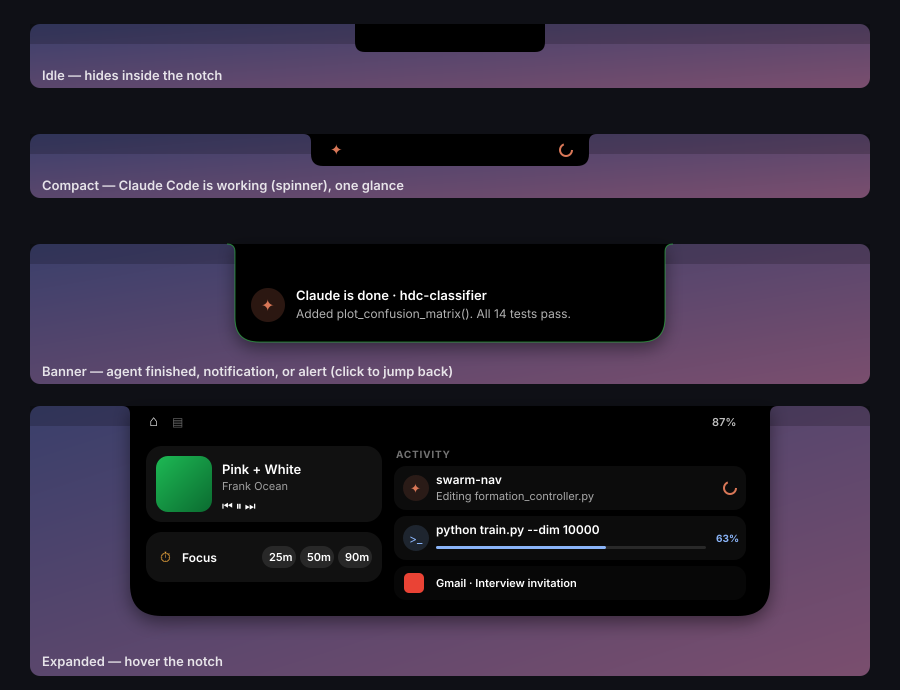

# Cove

**A Dynamic Island for the MacBook notch — built for people who run AI agents, long jobs, and too many apps at once.**

Cove turns the dead space around the notch into a live surface: it tells you the moment Claude Code or Codex finishes (or needs your approval), shows progress for training runs and builds, mirrors your notifications, and gives you music controls, a focus timer, and a drag-and-drop file shelf — all with iPhone-style spring animations.

Native Swift/SwiftUI, no dependencies, MIT licensed.



## Features

| | |
|---|---|
| **Agent pings** | Claude Code and Codex sessions appear as live activities. See what Claude is doing right now ("Editing eval.py", "$ pytest"), get an amber alert when it's waiting on a permission prompt, and a green banner with its final message when it's done. Click to jump back to the terminal it was running in. |
| **Long-command pings** | `cove-run python train.py` → elapsed timer in the notch, then a ping with how long it took and whether it failed. Push live progress (a ring + %) from Python with `examples/cove_progress.py`. |
| **Notifications** | Every macOS notification drops down from the notch with the app's icon. Notifications that contain words you care about (`interview`, `offer`, `deadline`…) turn amber and stay until you click them. |
| **Now Playing** | Album art + animated bars while Music or Spotify plays; play/pause/skip in the expanded view. |
| **Focus timer** | 25/50/90-minute sessions with a live countdown beside the notch. |
| **File shelf** | Drag files onto the notch to park them, drag them back out into any app later. |
| **Battery** | Charging and low-battery banners. |
| **HTTP API** | Anything that can `curl` can post to the island — scripts, robots, CI, a Raspberry Pi on your network via SSH tunnel. |

## Install

Requires macOS 14 (Sonoma) or later and the Swift toolchain (Xcode 15.3+ or the Command Line Tools: `xcode-select --install`).

```bash
git clone https://github.com/<you>/cove.git
cd cove
./scripts/install.sh
```

That builds `Cove.app`, copies it to `/Applications`, installs the CLI tools to `~/.local/bin`, connects Claude Code and Codex, and launches Cove. Then:

1. **Try it:** click the capsule icon in the menu bar → **Run demo**.
2. **Notifications:** System Settings → Privacy & Security → **Full Disk Access** → add Cove, then relaunch it (menu bar → Quit, reopen).
3. **Music:** the first time something plays, macOS asks to let Cove control Music/Spotify — allow it.
4. **Login:** menu bar → **Launch at login**.

> Rebuilding with the default ad-hoc signature makes macOS forget Cove's permissions. To keep them across rebuilds, create a self-signed *Code Signing* certificate in Keychain Access (e.g. "Cove Dev") and build with `COVE_SIGN_IDENTITY="Cove Dev" ./scripts/install.sh`.

Uninstall with `./scripts/uninstall.sh`.

## Agents

`install.sh` runs `scripts/install-hooks.sh`, which:

- **Claude Code** — adds hooks to `~/.claude/settings.json` for `UserPromptSubmit`, `PreToolUse`, `Notification`, `Stop`, and `SessionEnd`, all pointing at `cove-claude-hook`. The hook forwards Claude's JSON to Cove and prints nothing, so it never adds to your context and gives up after 1 second if Cove isn't running. A backup is saved as `settings.json.cove-backup`.
- **Codex** — sets `notify = ["~/.local/bin/cove-codex-notify"]` in `~/.codex/config.toml` (only if you don't already have a `notify` program).

Remove them any time with `./scripts/install-hooks.sh --uninstall`.

Any other agent or tool can report in through the API below.

## Long-running commands

```bash
cove-run python train.py --epochs 50
cove-run --name "Swarm sim" -- ros2 launch swarm sim.launch.py
cove-run make -j8
```

Inside a `cove-run` command, `$COVE_ACTIVITY_ID` is set, so a script can update the same activity with real progress:

```python
from cove_progress import Cove     # copy examples/cove_progress.py next to your script

cove = Cove("HDC training")
for epoch in range(1, epochs + 1):
    acc = train_one_epoch()
    cove.progress(epoch / epochs, f"epoch {epoch}/{epochs} · acc {acc:.3f}")
cove.done(f"best acc {best:.3f}")
```

## API

Cove listens on `127.0.0.1:7777` (loopback only).

| Method | Path | Body |
|---|---|---|
| `GET` | `/health` | — |
| `POST` | `/event` | `{"title": "…", "body": "…", "kind": "info", "id": "…", "progress": 0.4, "source": "command", "sticky": false}` |
| `POST` | `/hook/claude` | raw Claude Code hook JSON |
| `POST` | `/hook/codex` | raw Codex notify JSON |

`kind` is one of `info`, `running`, `done`, `error`, `attention`, `clear`. Events that share an `id` update one live activity, so `running → running (progress) → done` reads as a single task.

From the shell:

```bash
cove-notify "Coffee's ready"
cove-notify --kind attention "Robot 3 lost localization" "Battery at 12%"
cove-notify --id sweep --kind running --progress 0.4 "HDC sweep" "dim=10000, 4/10"
cove-notify --id sweep --kind done "HDC sweep" "best: 94.7%"
```

From another machine (say, a robot or a lab server), tunnel the port: `ssh -R 7777:127.0.0.1:7777 you@server`, then `curl` from there.

## Configuration

`~/.config/cove/config.json` is created on first launch. Edit it from the menu bar (**Open config…**) and choose **Reload config**.

| Key | Default | |
|---|---|---|
| `port` | `7777` | API port (restart to apply) |
| `sounds` | `true` | Sounds for done / attention / failure |
| `doneSound`, `attentionSound` | `"Glass"`, `"Ping"` | Any name from `/System/Library/Sounds` |
| `bannerSeconds` | `4.5` | How long ordinary banners stay |
| `hoverToExpand`, `hoverDelay` | `true`, `0.12` | Open on hover vs. click only |
| `mirrorNotifications` | `true` | Mirror macOS notifications |
| `ignoreApps` | `[]` | Bundle IDs to never mirror, e.g. `"com.tinyspeck.slackmacgap"` |
| `highlightKeywords` | `["interview", "offer", "deadline", …]` | Words that make a notification amber and sticky |
| `showToolActivity` | `true` | Show Claude's current tool ("Editing x.py") |
| `mediaApps` | `["com.spotify.client", "com.apple.Music"]` | Players to watch, in priority order |
| `batteryAlerts` | `true` | Charging / low battery banners |
| `focusMinutes` | `[25, 50, 90]` | Focus timer presets |

## How it works

```
Sources/Cove/
├── main.swift / AppDelegate.swift   app lifecycle, menu bar item, routing
├── IslandModel.swift                all state: activities, banner queue, media, focus, shelf
├── NotchWindow.swift                borderless panel above the menu bar, sized to the island
├── Views/                           IslandShape + idle / compact / banner / expanded views
└── Services/
    ├── EventServer.swift            Network.framework HTTP server on loopback
    ├── AgentBridge.swift            Claude Code hooks + Codex notify → activities
    ├── NotificationMirror.swift     reads Notification Center's DB (read-only)
    ├── NowPlayingMonitor.swift      Music / Spotify via AppleScript
    └── BatteryMonitor.swift         IOKit power-source callbacks
```

The island has four states, like the iPhone: **idle** (invisible inside the notch), **compact** (content in the two "wings" beside the notch), **banner** (drops down for a notification), and **expanded** (hover). The window is resized to the island's exact shape, so the rest of the menu bar stays clickable. Priority for the compact state: agent needs you → agent working → finished and unseen → focus timer → music.

## Known limitations

- **Notification mirroring** reads Notification Center's private database. It needs Full Disk Access and may break after a major macOS update; if it does, Cove just stops mirroring and everything else keeps working.
- Browser audio (YouTube, SoundCloud in Chrome) doesn't show in Now Playing — only Music and Spotify.
- Volume/brightness HUD replacement isn't implemented yet.

## Roadmap ideas

- [ ] Approve Claude Code permission prompts from the notch (`PreToolUse` decision hook)
- [ ] Volume / brightness HUD
- [ ] Calendar: next meeting countdown
- [ ] Clipboard history tab
- [ ] AirPods connect + battery
- [ ] Per-project colors for agent sessions

## License

MIT © 2026 Jason Thomas
